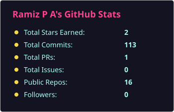
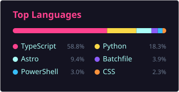

**🧑‍💻 AI/ML Enthusiast**

**🔐 AI/ML for InfoSec/CyberSecurity**

**🧑‍💻 Solutions Consultant - RFID & Mobility Solutions at Technowave Group**

**🎓 M.Tech In Artificial Intelligence & Machine Learning from BITS PILANI**

&nbsp;&nbsp;

