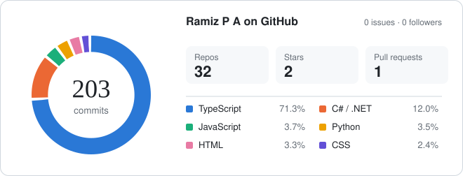

**🧑‍💻 AI/ML Architect & Asp.net/SQL Developer**

**🔐 AI/ML for InfoSec/CyberSecurity**

**🧑‍💻 Solutions Consultant - RFID & Mobility Solutions at Technowave Group**

**🎓 M.Tech In Artificial Intelligence & Machine Learning from BITS PILANI**

**Tech stack**

      

**Featured .NET projects** (source is private, overviews are public)

- [AuditSphere](https://github.com/ramizpa/auditsphere-showcase): barcode asset auditing with an Android app, .NET 8 API and web admin
- [DataWave IMS](https://github.com/ramizpa/datawave-ims-showcase): full-cycle inventory management on ASP.NET Core 10 and SQL Server

<picture>
<source media="(prefers-color-scheme: dark)" srcset="./assets/stats-dark.svg">

</picture>
